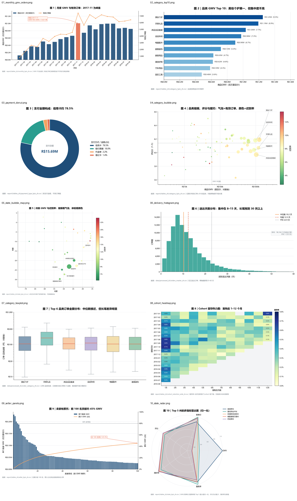

# Olist 巴西电商数据分析

> 从 9 张原始 CSV 到 10 类图表 + 9 页 Power BI 看板的完整分析链路：数据清洗 → 指标口径 → 图表底表 → 可视化 → BI 看板 → 文档。



## 项目亮点

- **不是画图练习**：代码只做清洗和指标，图表与看板是下游消费者，口径文档随代码一起交付；
- **可复现**：一条命令重跑全部 7 张明细表 + 28 张图表底表，运行清单记录每次的输入输出行数；
- **口径有据**：客户主键、GMV 与实付、迟到判定、多品类重复计数等易错点全部写明；
- **数据质量透明**：775 单无明细、417 单支付差额、610 个商品无品类等问题逐项标记，不静默删除。

## 核心结论

| 指标 | 数值 |
|---|---:|
| 有效订单 | 97,905 |
| 商品 GMV | R$ 13,449,530 |
| 含运费订单总额 | R$ 15,683,707 |
| 客单价 AOV | R$ 160 |
| 独立客户 | 94,703 |
| 复购客户占比 | 3.0% |
| 平均评论分 | 4.12 / 5 |
| 平均送达天数 | 12.54 天 |
| 迟到订单占比 | 8.1% |
| 信用卡占支付金额 | 78.5% |

几个能直接讲的发现：

1. **履约是体验短板**：迟到订单平均评分 2.57，准时订单 4.29；31–60 天送达的订单迟到率高达 81.1%。
2. **增长靠新客**：复购率仅 3.0%，Cohort 矩阵显示首购后各月留存低于 1%。
3. **地域高度集中**：圣保罗州占 GMV 38.3%，前五州合计 73.9%。
4. **卖家长尾很长**：Top 100 卖家累计贡献约 45.3% GMV。

## 分析流程

```text
9 张原始 CSV
   │  src/data_loader.py     类型强制、字段校验、时间范围
   ▼
维表清洗
   │  src/prepare.py         邮编中位数坐标、品类翻译、评论取最新
   ▼
订单级数据模型
   │  src/prepare.py         orders_master / items_enriched / order_category / order_seller
   │                          customer_rfm（五分位）/ cohort_retention
   ▼
28 张图表底表
   │  src/metrics.py         只聚合不画图，比例输出 0–1
   ▼
图表与看板
   │  notebooks/02_olist_10_charts.py   10 张中文图表
   │  dashboard/olist-dashboard.pbix    9 页 Power BI 看板
   ▼
交付文档
      report/analysis_summary.md、report/analysis_guide.md、report/PowerBI操作手册.docx
```

## 目录结构

```text
ecommerce-analysis/
├─ src/                     # 分析代码（清洗、指标、质量、中文映射、一键运行）
├─ notebooks/               # 10 张图表的 notebook 与脚本版
├─ data/
│  ├─ processed/            # 明细表（生成物，git 忽略）
│  └─ processed_zh/         # 中文明细表（生成物，git 忽略）
├─ report/
│  ├─ figures/              # 10 张图表 PNG + 拼图预览
│  ├─ tables/ tables_zh/    # 图表底表（生成物，git 忽略）
│  ├─ analysis_summary.md   # 自动生成的结论摘要
│  ├─ analysis_guide.md     # 每个图的字段与做法
│  ├─ Olist_10_charts.html  # 图表 HTML 预览
│  └─ PowerBI操作手册.docx    # 25 页建板手册
├─ dashboard/               # Power BI 看板、粘贴包、PBIP 补丁、主题
├─ docs/                    # 项目总结、验收分析、预览图
└─ scripts/                 # 手册生成、PBIX 结构解析工具
```

## 快速开始

```bash
# 1. 取数据：Kaggle - Brazilian E-Commerce Public Dataset by Olist
#    https://www.kaggle.com/datasets/olistbr/brazilian-ecommerce
#    解压到 Brazilian-Data/raw/（或 data/raw/，代码会自动识别）

# 2. 装依赖
python -m pip install -r requirements.txt

# 3. 一键生成明细表 + 图表底表 + Excel + 摘要
python src/run_analysis.py

# 4. 出 10 张图（也可直接打开 notebook）
python -m pip install -r requirements-notebooks.txt
python notebooks/02_olist_10_charts.py
```

运行后优先看：

1. `report/analysis_summary.md`：结论与口径；
2. `report/Olist_analysis_tables_zh.xlsx`：28 个中文工作表；
3. `report/figures/`：10 张图；
4. `report/Olist_10_charts.html`：不用 Jupyter 也能看。

## 10 张图

| # | 图 | 类型 | 回答的问题 |
|---|---|---|---|
| 1 | 月度 GMV 与订单数 | 双轴组合图 | 规模和增长节奏如何？ |
| 2 | 品类 GMV Top 10 | 横向条形图 | 哪些品类贡献最大？ |
| 3 | 支付构成 | 环形图 | 支付方式是否集中？ |
| 4 | 品类规模与体验 | 气泡散点图 | 规模、评分、订单量、迟到率的关系？ |
| 5 | 州级 GMV 与迟到率 | 地理气泡图 | 地域分布与履约差异？ |
| 6 | 送达天数分布 | 直方图 | 配送时长集中在哪一段？ |
| 7 | 品类订单金额分布 | 箱线图 | 头部品类的金额结构差异？ |
| 8 | Cohort 留存 | 热力矩阵 | 首购后各月还回来吗？ |
| 9 | 卖家帕累托 | 帕累托图 | 收入是否依赖头部卖家？ |
| 10 | Top 5 州雷达 | 雷达图 | 哪些州更均衡？ |

## Power BI 看板

- `dashboard/olist-dashboard.pbix`：9 页看板（趋势 / 品类 / 支付 / 体验 / 地图 / 履约 / 箱线与雷达 / Cohort / 卖家）；
- `dashboard/pbi_paste_pack/`：DAX 度量值、主题、逐图配方；
- `dashboard/pbi_pbip_patch/`：PBIP 报告定义补丁——PBIX 报告层有完整性校验，外部改写会损坏，正确做法是另存为 PBIP 后改定义再另存回 PBIX；
- `docs/PowerBI验收分析.md`：这版看板的实测结论与待修问题。

## 关键口径

| 问题 | 处理方式 |
|---|---|
| 客户主键 | 用 `customer_unique_id`，`customer_id` 是订单级的，用它算复购会算成 0 |
| 收入口径 | `gmv` 不含运费、`gross_order_value` 含运费、`payment_value` 只用于对账 |
| 迟到判定 | 实际送达日期 > 预计送达日期 |
| 多品类订单 | 品类/卖家表按 order-category、order-seller 粒度，收入可加、订单数不可加 |
| 评论 | 一单多评时取最新一条，另保留均值与条数 |

## 局限

- 数据没有成本与流量，**算不出利润、ROI、CAC**；
- 公开数据集、单一平台，结论不能直接外推到其他市场；
- BI 里的箱线图与雷达图是静态 PNG，不随筛选联动；
- 看板暂无切片器，时间/品类/州还不能统一切换。

## 文档索引

- [docs/项目总结.md](docs/项目总结.md)：全流程说明与设计决策
- [report/analysis_guide.md](report/analysis_guide.md)：28 张底表的字段、口径与推荐图形
- [report/analysis_summary.md](report/analysis_summary.md)：自动生成的结论摘要
- [docs/PowerBI验收分析.md](docs/PowerBI验收分析.md)：看板验收记录

## 数据来源

数据来自 Kaggle 公开数据集 [Brazilian E-Commerce Public Dataset by Olist](https://www.kaggle.com/datasets/olistbr/brazilian-ecommerce)，遵循其原始许可；本仓库只包含代码、图表与文档，不分发原始数据。